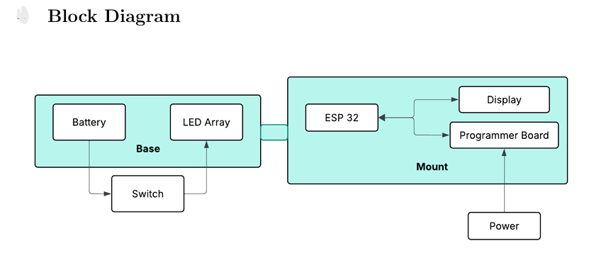
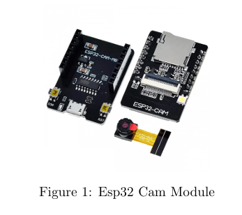
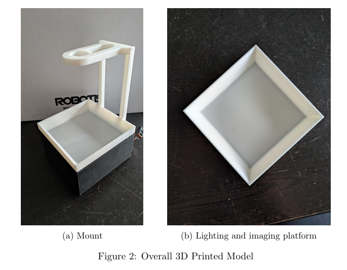

# Parts Counter Based on Blob Algorithm

A low-cost parts counter built on the **ESP32-CAM**. Small parts like screws, nuts and resistors are placed on a backlit tray, and the device counts them in real time using blob detection, showing the count on an OLED display. No PC needed, and the total cost is about **₹1,800**.

## Block Diagram

## How It Works

1. The ESP32-CAM captures a grayscale image of the tray.
2. On startup, it detects the bright lit tray and locks it in as the counting area (ROI).
3. Pixels darker than the tray's average brightness are marked as parts.
4. Connected groups of these pixels (blobs) are found using flood fill.
5. Blobs that are too small (dust) or too large (clumps) are ignored.
6. The final count is shown on the OLED, updating continuously.

## Hardware

| Component | Qty | Cost (₹) |
|---|:-:|--:|
| ESP32-CAM module | 1 | 740 |
| USB programmer board | 1 | 220 |
| 0.96" OLED display | 1 | 420 |
| LED strip | 1 | 323 |
| 9V battery | 1 | 90 |
| **Total** | | **1,793** |

## 3D-Printed Parts

| Part | Description |
|---|---|
| `base.stl` | Houses the battery, switch and LED strip |
| `tray.stl` | White diffusing tray that the parts are placed on |
| `stand.stl` | Holds the camera at a fixed height above the tray |

## Code

| File | Description |
|---|---|
| `code/parts_counter/parts_counter.ino` | Main firmware: auto ROI calibration, blob counting and OLED output |

## Limitations

- Touching or overlapping parts are counted as one.
- Shiny or reflective parts can cause wrong counts.
- Low camera resolution makes very small parts harder to detect.

